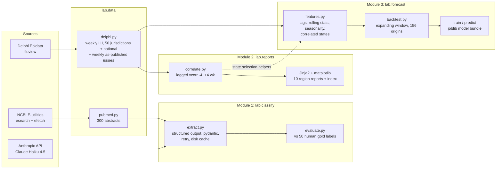
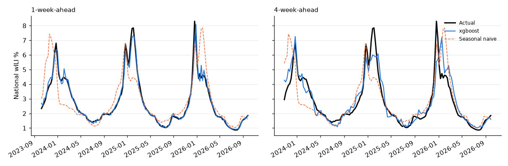

# health-signals-lab

Three small, reproducible pipelines on public respiratory-virus data:

1. **LLM literature extraction**: pull 300 PubMed abstracts on influenza/RSV surveillance and forecasting, extract structured fields with Claude (validated JSON, retries, disk cache), and evaluate the extracted `study_type` against 50 human labels.
2. **Automated lead/lag reports**: weekly influenza-like illness (ILI) for every US state from CDC ILINet (via Delphi Epidata), lagged cross-correlations between states, and one templated HTML report per HHS region.
3. **ILI forecasting**: 1–4-week-ahead national ILI with LightGBM and XGBoost against persistence, seasonal-naive and ARIMA baselines, in a rolling-origin backtest with leakage tests, an untouched holdout season, and a real-time (as-published) data check.

Every number in [Results](#results) is copied from a file the code writes; the source file is linked next to each table.

## Architecture



## How to run

```bash
conda create -n hsl python=3.11 && conda activate hsl
pip install -e ".[dev]"
conda install llvm-openmp          # macOS only: LightGBM needs the OpenMP runtime
cp .env.example .env               # add ANTHROPIC_API_KEY (Module 1); DELPHI_API_KEY optional
```

| Command | What it does |
|---|---|
| `make data` | Download ILINet (Delphi) and PubMed abstracts to `data/raw/` (cached) |
| `make reports` | Module 2 → `outputs/reports/index.html` (also `python -m lab.reports`) |
| `make forecast` | Module 3: backtest → results → train → predict next 4 weeks |
| `make classify` | Module 1: Claude extraction over the 300 abstracts (cached; reruns are free) |
| `make evaluate` | Score `study_type` against the human labels in `data/gold_labels.csv` |
| `make test` | 23 pytest tests (leakage, pipeline shape, correlation, extraction with a fake client) |

Configuration lives in [`config.yaml`](config.yaml). Keys are read from `.env` (git-ignored), which overrides stale shell variables; nothing is hardcoded.

## Results

### Module 2: Which states lead? (weekly ILI, 2018-09-30 to 2026-09-27)

418 weeks, 8 seasons, 49 states + DC. Sources: [`xcorr_vs_national.csv`](outputs/reports/xcorr_vs_national.csv), [`xcorr_state_pairs.csv`](outputs/reports/xcorr_state_pairs.csv), [reports index](outputs/reports/index.html).

| Check | Result |
|---|---|
| States vs national, peak lag of week-over-week change | **All 50 at lag 0** |
| Correlation with national at lag 0 | median 0.65 (range 0.31 for AK to 0.85 for IL) |
| All 1,225 state pairs | 1,117 peak at lag 0; 15 meet the lead rule, all cross-region and weak (peak r 0.30–0.43, median 0.35), 14 of them a 1-week lead; strongest MN→PA (r = 0.43 vs 0.37 at lag 0) |
| Within-HHS-region pairs (110) | 0 meet the lead rule |
| Excluding COVID seasons | peak lag vs national changes for 1 of 50 states |
| Excluding holiday weeks | changes for 3 of 50 states |
| Seasonal peak timing (6 non-COVID seasons, 3-week smoothed) | 39 of 50 states peak within ±1 week of national; AK earliest (median −5.5 wk), IA latest (+5.0 wk) |

**Finding:** at weekly resolution, no state's ILI changes reliably precede the nation's. States move together, and differences show up only in seasonal peak timing.

### Module 3: Forecasting national ILI 1–4 weeks ahead

156 weekly origins (2023-10-01 to 2026-09-20), refit at every origin on data up to that week only. Source: [`outputs/forecast/results.md`](outputs/forecast/results.md).

**MAE (ILI percentage points)**

| Model | 1 wk | 2 wk | 3 wk | 4 wk |
|---|---|---|---|---|
| Persistence (no change) | 0.282 | 0.514 | 0.699 | 0.862 |
| Seasonal naive (last year) | 0.707 | 0.708 | 0.707 | 0.701 |
| ARIMA(2,1,1) on log ILI | 0.207 | 0.454 | 0.707 | 0.884 |
| LightGBM | 0.156 | 0.317 | 0.441 | 0.539 |
| **XGBoost** | 0.161 | 0.273 | 0.370 | 0.435 |
| LightGBM + correlated states | 0.168 | 0.316 | 0.424 | 0.484 |
| XGBoost + correlated states | 0.175 | 0.292 | 0.370 | 0.436 |

- **XGBoost MAPE:** 4.8% / 8.5% / 11.5% / 14.1% at 1–4 weeks.
- **Skill vs persistence:** XGBoost has 42.9% / 46.9% / 47.1% / 49.5% lower MAE at 1–4 weeks. Against ARIMA it is 50.8% lower at 4 weeks.
- **Peak weeks are harder:** in the 37 weeks where actual ILI ≥ 4%, XGBoost's 4-week MAE is 0.910, against 0.284 in other weeks.
- **Correlated states (IL, TN, PA, CA, GA):** about no change overall for XGBoost at 4 weeks (0.435 → 0.436). They help in other weeks (0.284 → 0.241) and hurt in peak weeks (0.910 → 1.047), so the production model leaves them out.
- **Untouched holdout:** the model was chosen on target weeks before 2025-09-28 (103 origins). XGBoost ranked 1st there and is also **1st on the 2025-26 holdout** (52 origins), with mean MAE 0.374 across horizons. The four ML variants keep the same ranking (1–4) on both periods. Holdout 4-week MAE is 0.534 for XGBoost and 0.960 for persistence.
- **Real-time vs revised data:** first-reported national ILI differed from final values by a mean absolute 0.024 points (max 0.142) over 150 origins with a published issue. Rerunning on as-published data changed MAE by at most ±3.0% for every model and horizon (XGBoost 4-week: 0.435 → 0.432).



### Module 1: LLM literature extraction

Model `claude-haiku-4-5-20251001`. Sources: [`summary.md`](outputs/classify/summary.md), [`evaluation.md`](outputs/classify/evaluation.md).

- **Extraction:** 300 / 300 abstracts extracted with 0 retries and 0 failures. Tokens: 413,798 input + 33,284 output ≈ **$0.58**.
- **Predicted study types:** surveillance 161, forecasting 89, review 26, other 15, clinical 9.
- **Methods:** 204 abstracts name at least one method. The most common families are regression (49), other time-series methods (28), LSTM/RNN (23), ARIMA (21) and lab/genomic methods (20). Full table by year: [`methods_by_year.csv`](outputs/classify/methods_by_year.csv).

**Evaluation against 50 human labels** (labeled blind, before any model output was viewed):

| Metric | Value |
|---|---|
| Accuracy | **0.740** |
| Macro F1 | 0.705 |
| Cohen's kappa | 0.648 |

| Class | Precision | Recall | Support |
|---|---|---|---|
| forecasting | 0.929 | 0.929 | 14 |
| surveillance | 0.577 | 1.000 | 15 |
| clinical | 1.000 | 0.333 | 9 |
| review | 1.000 | 1.000 | 4 |
| other | 0.667 | 0.250 | 8 |

11 of the 13 disagreements are abstracts Claude labeled `surveillance` that the human labeled `clinical` (6) or `other` (5). Examples are population-level trends in pediatric hospitalizations, vaccination in pregnancy, and wastewater detection methods. These sit on a genuine boundary: the `surveillance` definition mentions "burden" and "trends", which covers them. Forecasting, the class this lab cares most about, reaches 0.929 precision and recall. Disagreements are listed in [`evaluation_errors.csv`](outputs/classify/evaluation_errors.csv).

## Methodological decisions

**Correlate week-over-week changes, not raw ILI levels (Module 2).**
- Every state's ILI peaks in winter, so raw levels correlate at about 0.9 at lag 0 almost everywhere. That shared seasonality hides who moves first.
- First differences remove it, so a peak at lag k ≠ 0 reflects timing rather than calendar.
- Convention: r(k) = corr(ΔA_t, ΔB_{t+k}); a peak at k > 0 means A leads B.

**A "lead" must clearly beat lag 0.**
- A pair counts as a lead only if the peak lag is ≠ 0, peak r ≥ 0.3, and peak r is at least 0.05 higher than r at lag 0 (about one standard error of r at n ≈ 400).
- Without the gain rule, 35 pairs qualify, with a median gain over lag 0 of only 0.045, which is within the noise of scanning 1,225 pairs.

**Robustness checks, not a search for leaders.**
- Two pre-registered checks: masking COVID seasons, and masking holiday weeks (MMWR weeks 51–2, when routine visits drop and ILI % jumps nationwide in the same week).
- Weeks are masked to NaN rather than dropped, so a lag of k always means k calendar weeks.
- Seasonal peaks are found on a 3-week rolling mean so a single holiday spike isn't counted as the peak.
- After these checks I stopped. Trying other transforms until a leader appeared would be fishing.

**COVID seasons are flagged, not deleted.**
- 2020-21 and 2021-22 stay in the data, shaded in charts, and get their own robustness line in every report.
- Module 3 drops them from training rows only.
- The test seasons (2023-26) contain no COVID weeks, so the forecast metrics need no "with/without COVID" split.

**Data coverage: FL, NY/NYC, territories.**
- A jurisdiction must have at least 85% of weeks (about 7 of 8 seasons).
- **Florida is excluded:** ILINet has FL data only from 2021-W40.
- **NY:** the combined NY series and NYC (`jfk`) both end at 2025-W39, so NY is represented by "NY excl. NYC" (`ny_minus_jfk`, complete) and NYC is excluded.
- **PR and VI are excluded** as territories outside the 50 states + DC comparison.
- **Kept and flagged:** AK, CT, HI, OK, OR, SD and UT are missing only the 2025-26 season. Each report states this.
- The national series includes every state, so part of each state's lag-0 correlation with national is mechanical, most so for large states.

**"Correlated states", not "leading states", with selection kept out of the backtest (Module 3).**
- Module 2 found no state that leads national, so the planned leading-state feature was replaced.
- Its replacement is the 5 states whose weekly changes correlate most with national at lag 0 (IL, TN, PA, CA, GA).
- They are chosen using only data before the first backtest origin, and a test asserts that changing later data can't change the selection.
- The backtest reports every tree model with and without these features.

**Model design.**
- One direct model per horizon.
- The target is log(y[t+h] / y[t]), so tree models can forecast peaks higher than any seen in training.
- Features: lags 0–3, a 1-week difference, 4- and 8-week rolling mean and std, last year's value at the target week, and the target week's seasonality (sin/cos).

**No look-ahead.**
- Every origin refits on a series truncated at that week.
- The code asserts that no training label falls after the origin.
- The tests corrupt every week after each origin and check that the forecasts are identical, and that features at week t depend only on weeks ≤ t.

**Model selection without optimism.**
- The production model (XGBoost, national features only) was chosen on 2023-24 and 2024-25 targets only.
- The 2025-26 season was then scored as an untouched holdout, and the ranking held.
- Baselines include persistence, the standard flu-forecasting reference, so skill isn't measured only against a weak seasonal-naive baseline.

**Revised vs real-time data.**
- Delphi serves final, revised ILI by default, which flatters a backtest.
- Using the `issues` parameter, the national-only models were rerun on each week's data exactly as CDC first published it.
- 6 of 156 origins (2025-W39 to W44) have no published issue in Delphi and fall back to final values.
- This result applies to national data. State-level revisions are typically larger and were not tested.
- `predict` forecasts from the newest published week, which is preliminary; the revision check above shows that is a small effect at national level.

**LLM extraction (Module 1).**
- Claude's structured output (`messages.parse` with a Pydantic schema), plus our own validators (one-sentence finding, de-duplicated lists).
- Up to 3 attempts on refusal, truncation or failed validation.
- A disk cache keyed on model, prompt and abstract makes reruns free and reproducible.
- The 5 class definitions are shared word-for-word by the prompt and the human labeling guide.
- The 50 gold labels were made by a human before any model output was viewed, and the prompt was **not** tuned on them, so the reported accuracy is a test-set number.
- Method names are grouped into families with transparent regexes ([`methods.py`](src/lab/classify/methods.py)); 87 long-tail mentions remain "Other".

## Limitations

- One annotator labeled the gold set, so there is no inter-annotator agreement. The clinical/surveillance boundary should be tightened in the definitions and re-checked on a new sample.
- The PubMed query is ranked by relevance and also returns COVID-19 and general influenza papers. The extracted counts describe this sample of 300, not the whole field.
- Forecasts are point forecasts. The CDC FluSight standard is probabilistic (quantiles and WIS), which is a natural next step.
- The backtest covers 3 seasons; peak-week error rests on 37 weeks per horizon.

## Data sources

- CDC ILINet via the [Delphi Epidata API](https://cmu-delphi.github.io/delphi-epidata/api/fluview.html) (`fluview`).
- PubMed via [NCBI E-utilities](https://www.ncbi.nlm.nih.gov/books/NBK25499/).
- Extraction with the [Anthropic API](https://docs.anthropic.com/).
